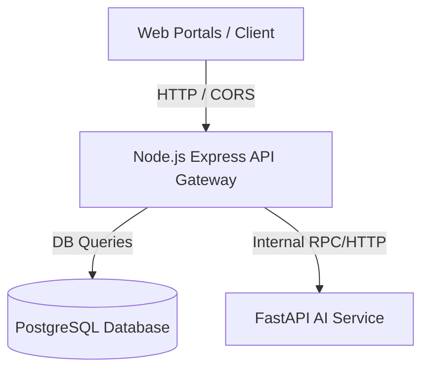

# MediSync AI

AI-Powered Triage Chatbot, Prescription Digitizer, EHR & Pharmacy Portal.
CSE327 Software Engineering Project under faculty Intisar Tahmid Naheen [ITN].

---

## Architecture Overview

MediSync AI leverages a modern, distributed microservices architecture designed to integrate AI capabilities with clinical workflows:



- **Frontend (Web Portals):** React with Vite, styled using Tailwind CSS, structured as a monorepo workspace.
- **Backend (API Gateway):** Node.js Express API Gateway handles client authorization, request routing, database access, session hook management, and medication alerts.
- **AI Microservice:** Python 3.12 FastAPI service executing OCR prescriptions, symptoms triage, and local AI logic stubbing.
- **Database:** PostgreSQL storing relational clinical records, master drugs catalog, pharmacy inventory, and sessions.
- **Orchestration:** Managed via Docker Compose for easy local bootstrap and execution.

---

## Getting Started

### Prerequisites

To build and run the services locally outside Docker:
- **Node.js** (v18+)
- **pnpm** (v9.0.0+)
- **Python** (v3.12)
- **PostgreSQL** (v15+)

---

### Run with Docker Compose (Recommended)

Start all services (database, backend, frontend, and AI service) automatically with a single command:

```bash
docker-compose up --build
```

- Web Portal: **http://localhost:3000**
- API Gateway: **http://localhost:3001**
- AI Service: **http://localhost:8000**

---

### Local Manual Installation

If you prefer to run services individually for development:

#### 1. Database Initialization
Ensure PostgreSQL is running. Create a database named `medisync_db`.

**Linux:**
```bash
createdb -U postgres medisync_db
```

**Windows:**
```sql
CREATE DATABASE medisync_db;
```

#### 2. Environment Configuration
Copy the example environment file:
```bash
cp .env.example .env
```
Open `.env` and define:
- `DATABASE_URL` — your PostgreSQL connection string
- `JWT_SECRET` — a strong random string
- `ENCRYPTION_KEY` — exactly 32 characters

#### 3. Install Node.js Dependencies
From the **root directory**:
```bash
pnpm install
```

#### 4. Install Python AI Service Dependencies
```bash
cd apps/ai-service
python3 -m venv venv
source venv/bin/activate
pip install -r requirements.txt
```

---

### Running Locally (Without Docker)

#### 1. Start AI Service (FastAPI)
```bash
cd apps/ai-service
source venv/bin/activate
python -m uvicorn main:app --host 127.0.0.1 --port 8000 --reload
```

#### 2. Start Backend API & Web Portal
From the **root directory**:
```bash
# Run both Backend and Frontend simultaneously
pnpm dev:all
```
Alternatively:
```bash
pnpm dev:backend   # Start API Gateway (Port 3001)
pnpm dev           # Start Web Portals (Port 3000)
```

---

### Database Migration and Seeding

#### Apply Schema
```bash
npm run db:init
```

#### Seed Mock Data
```bash
npm run db:seed
```

**Seed Users** (all passwords: `Test@1234`):
- Admin: `admin@medisync.ai`
- Patient: `patient@medisync.ai`
- Doctor: `doctor@medisync.ai`
- Pharmacy: `pharmacy@medisync.ai`

---

### Testing the Application

#### Step 1 — Health Checks
```bash
curl http://localhost:3001/health
curl http://127.0.0.1:8000/health
```

#### Step 2 — Register & Authenticate
```bash
curl -X POST http://localhost:3001/api/auth/register \
  -H "Content-Type: application/json" \
  -d '{
    "fullName": "Test Patient",
    "email": "testpatient@test.com",
    "password": "Test@1234",
    "role": "PATIENT"
  }'
```

---

## Documentation
- [Setup & Installation Guide](docs/SETUP_GUIDE.md)
- [API Reference Manual](docs/API_REFERENCE.md)
- [System Architecture](docs/ARCHITECTURE.md)

## Versioning
This project follows strict Semantic Versioning (SemVer) guidelines. The base version is **`0.1.0`**.
