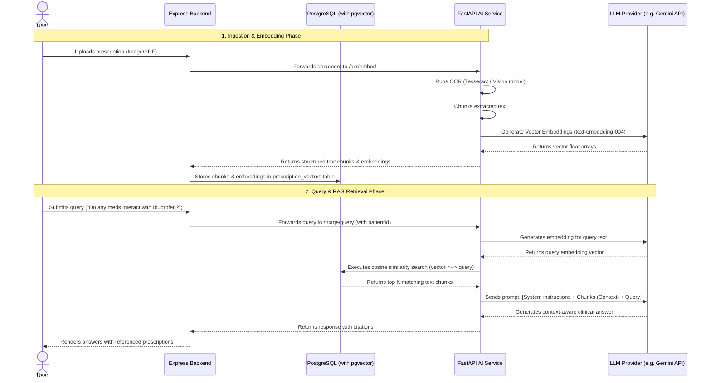

# Implementing OCR with Retrieval-Augmented Generation (RAG) in MediSync AI

This architectural guide outlines how to integrate RAG with the prescription/document OCR pipeline. This enables patients and doctors to query clinical histories and scanned prescriptions dynamically with high accuracy and safety.

---

## 1. High-Level Concept & Workflow

Retrieval-Augmented Generation (RAG) combines document information extraction with LLM reasoning. When applied to OCR:
1. **Ingest Phase (OCR & Embedding)**: A user uploads a prescription image or clinical report PDF. The system extracts raw text via OCR, chunks the text, creates high-dimensional vector embeddings, and stores them in PostgreSQL using the `pgvector` extension.
2. **Query Phase (Retrieval & Synthesis)**: When the user asks a question (e.g., *"When should I take my fever medicine?"* or *"Do any of my current prescriptions interact with Ibuprofen?"*), the system embeds the query, retrieves matching segments from the database, and feeds them as context to the LLM to generate an accurate, referenceable response.

### System Architecture Flow



---

## 2. Step-by-Step Implementation

### Step 1: Database Setup (`pgvector` Extension)

Enable the vector extension in PostgreSQL and create the vector storage table.

Modify the database schema:

```sql
-- Enable vector extension
CREATE EXTENSION IF NOT EXISTS vector;

-- Table for storing chunked document/prescription text vectors
CREATE TABLE prescription_vectors (
    vector_id UUID PRIMARY KEY DEFAULT gen_random_uuid(),
    prescription_id UUID REFERENCES prescriptions(prescription_id) ON DELETE CASCADE,
    patient_id UUID REFERENCES users(user_id) ON DELETE CASCADE,
    chunk_content TEXT NOT NULL,
    embedding VECTOR(768), -- Dimension of standard Google text-embedding models
    created_at TIMESTAMP WITH TIME ZONE DEFAULT CURRENT_TIMESTAMP
);

-- Index for fast cosine similarity search
CREATE INDEX ON prescription_vectors USING hnsw (embedding vector_cosine_ops);
```

---

### Step 2: Python AI Service updates (`apps/ai-service`)

Install additional requirements in `apps/ai-service/requirements.txt`:
```text
sentence-transformers==3.0.1  # For local embeddings (or use google-generativeai API)
langchain-text-splitters==0.2.0  # For chunking document text
```

In the FastAPI application (`apps/ai-service/main.py`), implement endpoints for chunking/embedding, and vector matching:

```python
from fastapi import FastAPI, UploadFile, File
from langchain_text_splitters import RecursiveCharacterTextSplitter
import google.generativeai as genai
import numpy as np

# Configure Gemini API
genai.configure(api_key="YOUR_GEMINI_API_KEY")

text_splitter = RecursiveCharacterTextSplitter(
    chunk_size=500,
    chunk_overlap=50
)

@app.post("/ocr/embed")
async def extract_and_embed(file: UploadFile = File(...)):
    # 1. Perform OCR extraction
    extracted_text = run_ocr_on_file(file)
    
    # 2. Chunk text
    chunks = text_splitter.split_text(extracted_text)
    
    # 3. Embed chunks via Gemini api
    response = genai.embed_content(
        model="models/text-embedding-004",
        contents=chunks,
        task_type="retrieval_document"
    )
    embeddings = response['embeddings']
    
    # Return chunks and their high-dimensional vector representations to Node backend
    return {
        "success": True,
        "chunks": [{"content": chunk, "embedding": emb} for chunk, emb in zip(chunks, embeddings)]
    }
```

---

### Step 3: Integrating Node.js Express Backend (`apps/backend`)

Update the Node.js prescription upload logic (`apps/backend/src/controllers/prescriptions.controller.ts`):

```typescript
import { query } from '../config/database';

export const uploadAndIndexPrescription = async (req: Request, res: Response) => {
  const { patientId } = req.body;
  const file = req.file;

  // 1. Send file to FastAPI for OCR and Embeddings
  const aiResponse = await axios.post(`${config.aiServiceUrl}/ocr/embed`, formData, {
    headers: formData.getHeaders()
  });

  const { chunks } = aiResponse.data;

  // 2. Save prescription metadata
  const prescription = await query(
    'INSERT INTO prescriptions (patient_id, file_path) VALUES ($1, $2) RETURNING *',
    [patientId, file.path]
  );

  // 3. Batch insert vectors into PostgreSQL
  for (const chunk of chunks) {
    // Formats embedding float array to PostgreSQL vector syntax: '[0.1, 0.2, 0.3...]'
    const vectorString = `[${chunk.embedding.join(',')}]`;
    
    await query(
      `INSERT INTO prescription_vectors (prescription_id, patient_id, chunk_content, embedding) 
       VALUES ($1, $2, $3, $4::vector)`,
      [prescription.rows[0].prescription_id, patientId, chunk.content, vectorString]
    );
  }

  res.status(201).json({ success: true, message: 'Prescription indexed and embedded successfully' });
};
```

---

### Step 4: Context-Aware Query Endpoint

Implement the RAG retrieval and generation cycle on FastAPI or Express. Here is the query cycle query database look:

```typescript
export const queryClinicalHistory = async (req: Request, res: Response) => {
  const { queryText, patientId } = req.body;

  // 1. Get embedding for the user's question from LLM / Embedding model
  const queryEmbeddingResponse = await axios.post(`${config.aiServiceUrl}/embed-query`, { text: queryText });
  const queryVector = `[${queryEmbeddingResponse.data.embedding.join(',')}]`;

  // 2. Query pgvector for semantic cosine similarity match
  const matches = await query(
    `SELECT chunk_content, 
            (embedding <=> $1::vector) as distance 
     FROM prescription_vectors 
     WHERE patient_id = $2 
     ORDER BY distance ASC 
     LIMIT 5`,
    [queryVector, patientId]
  );

  const context = matches.rows.map(r => r.chunk_content).join('\n\n');

  // 3. Send Context + User Query to LLM for final generation
  const assistantResponse = await axios.post(`${config.aiServiceUrl}/triage/chat-rag`, {
    query: queryText,
    context: context
  });

  res.json({
    success: true,
    answer: assistantResponse.data.answer,
    sources: matches.rows.map(r => ({ content: r.chunk_content, score: 1 - r.distance }))
  });
};
```

---

## 3. Advantages of this Approach

1. **Safety and Precision**: The LLM's response is strictly grounded in the patient's verified prescription history, eliminating AI hallucinations about drug names or dosages.
2. **Unified Stack**: Since PostgreSQL already serves as the core database, utilizing `pgvector` removes the architectural overhead of introducing a separate vector database (like Pinecone or ChromaDB).
3. **Auditability**: You can map each answer directly back to its source prescription segment (providing citations/references for doctors to verify).

---

## 4. Current OCR Pipeline Architecture & Dynamic Web Search Correction

```
┌─────────────────────────────────────────────────────────────────────────┐
│                    MediSync OCR Ingestion Pipeline                      │
└────────────────────────────────────┬────────────────────────────────────┘
                                     │
                                     ▼
┌─────────────────────────────────────────────────────────────────────────┐
│ PRIMARY OCR ENGINE: Mistral OCR API (mistral-ocr-latest)                │
│  - Dedicated document OCR model with layout structure preservation      │
│  - Preserves markdown headers, medical symbols, English & Bengali text  │
│  - Extracts doctor metadata, patient details, and medicine line items   │
└────────────────────────────────────┬────────────────────────────────────┘
                                     │ (Fallback if offline)
                                     ▼
┌─────────────────────────────────────────────────────────────────────────┐
│ FALLBACK LOCAL ENGINE: Process-Isolated Dual-Pass PaddleOCR             │
│  - Pass A: Standard Contrast RGB Image Extraction                       │
│  - Pass B: CLAHE Contrast Enhanced & Kernel Sharpened Image Extraction  │
│  - Noise Cleaner & Medical Regex Parser (cleaner.py & parser.py)        │
│  - Memory Protection: max_tasks_per_child=1 ProcessPoolExecutor         │
│    (100% RAM release per task; RSS locked at ~55 MB)                    │
└────────────────────────────────────┬────────────────────────────────────┘
                                     │
                                     ▼
┌─────────────────────────────────────────────────────────────────────────┐
│ 100% DYNAMIC WEB SEARCH DRUG CORRECTION PIPELINE (WebSearchService)    │
│  - Formulates search queries with dosage form (Tab/Cap/Syp) & strength │
│    e.g.: "Tab Elopile A medicine Bangladesh" or "Tab Bisoxen 2.5mg"    │
│  - Extracts real-time candidate brand suggestions from web snippets     │
│  - Dynamically validates candidates against master_pharmacy (21,231 DB) │
│  - 0 Hardcoded names: Works dynamically across any doctor prescription  │
└────────────────────────────────────┬────────────────────────────────────┘
                                     │
                                     ▼
┌─────────────────────────────────────────────────────────────────────────┐
│ CLINICAL COHERENCE & PATIENT NEED SAFETY CHECK (ClinicalSafetyService)  │
│  - Cross-references matched drug therapeutic class against patient      │
│    diagnosed conditions (e.g. HTN, OMI, PCI, Vertigo, GERD)             │
│  - Automatically flags low-confidence or unaligned medicines with       │
│    `requiresReview: true` and clear clinical review reasons             │
└─────────────────────────────────────────────────────────────────────────┘
```

### Open Issues & Future Enhancements
- **Tracking Issue**: [GitHub Issue #1: Handwritten Prescription OCR Improvement](https://github.com/yasirFakir/medisync/issues/1)
- **Implemented Upgrades**:
  1. Clinical Coherence & Patient Need Safety Check ([apps/backend/src/services/clinicalSafety.service.ts](file:///home/yasir/Data/dev/Projects/medisync/apps/backend/src/services/clinicalSafety.service.ts)).
  2. 100% Dynamic Web Search Grounding Pipeline ([apps/backend/src/services/webSearch.service.ts](file:///home/yasir/Data/dev/Projects/medisync/apps/backend/src/services/webSearch.service.ts)).
  3. Levenshtein + 3L/2L Prefix Fuzzy Matching against `master_pharmacy` (21,231 records).
